# Clasificación de la gravedad de los siniestros viales en la Ciudad de Buenos Aires

## Carátula

**Título.** Clasificación de la gravedad de los siniestros viales en la Ciudad de Buenos Aires, 2019-2025.

**Estudiante.** Santiago Baldini Cuevas

**Materia.** Licenciatura en Gestión de TI — Inteligencia de negocios, 2026. UNPAZ.

**Documento de entrega.** El archivo para editar es [informe.docx](informe.docx). La versión impresa está en [informe.pdf](informe.pdf), generada desde [entrega-tres.html](entrega-tres.html). La presentación oral está en [presentacion.html](presentacion.html).

### Abstract

Este trabajo clasifica los siniestros viales con víctimas registrados en la Ciudad de Buenos Aires por el Observatorio de Movilidad y Seguridad Vial entre el 1 de enero de 2019 y el 31 de diciembre de 2025. La pregunta es si un hecho ya ocurrido fue leve, grave o mortal. El archivo de hechos reúne 65.818 siniestros y pesa 12,2 MB. De ellos, 62.174 son leves, 2.955 graves y 689 mortales, cerca del 1 %. Con esa proporción, responder siempre «leve» acierta el 94,5 % y no encuentra ni un grave ni una muerte, así que el acierto global no alcanza para elegir un modelo. La notebook de análisis muestra la caída de hechos en 2020, una tasa más alta entre peatones que entre motos, una tasa más alta en autopista que en calle, y una tasa de madrugada varias veces mayor que la de la tarde. Esas métricas deciden el preprocesado: el hueco de la hora se marca con un indicador, el faltante de las categorías queda como SIN_DATO, y el desbalance se trata con un peso de clase de 31,85 para el mortal, 7,42 para el grave y 0,35 para el leve. Sobre esa matriz se ajustan una regresión logística, un árbol de decisión de profundidad 5 y un random forest de 200 árboles. En la prueba, de 13.164 hechos, el forest es el elegido por el recall macro: 62,1 %. Encuentra 117 de 138 muertes y 276 de 591 graves. El análisis, el código y este documento se hicieron con el modelo Grok 4.7.

## 1. Estado del arte y fundamentación

Clasificar la gravedad de un siniestro vial es un uso corriente de la inteligencia artificial aplicada al transporte. Ali, Hussain y Haque (2024) revisan modelos de ocurrencia, de frecuencia y de gravedad, y marcan dos cuidados que este trabajo toma al pie de la letra: el desbalance de la clase grave tiene que tratarse con una técnica explícita, y no conviene mezclar definiciones distintas de gravedad. Hamdan y Sipos (2025) recorren 32 estudios de 2020 a 2025 y encuentran que los modelos más usados para la gravedad son random forest, XGBoost y SVM, y que el tipo de vía y el tipo de usuario cambian el resultado. Butt y Shafique (2025) describen el paso de los modelos estadísticos a redes y ensembles, con una utilidad de gestión: decidir dónde intervenir.

Esas tres lecturas, todas de 2024 o 2025, justifican el tema y el diseño. La muerte en la vía sigue ocurriendo en la Ciudad, la serie oficial llega a 2025 y el portal la actualizó el 29 de junio de 2026. Un clasificador de tres niveles, leve, grave o mortal, permite ver qué combinaciones concentran cada gravedad. Esa lectura sirve a la gestión de la movilidad. No reemplaza la causa judicial ni señala un culpable.

La definición que se usa es la del propio observatorio, citada como fuente de los datos y no como uno de los tres papers. Mortal es la muerte dentro de los 30 días. Grave es la lesión con internación de al menos 24 horas. Si hay varias víctimas, manda la más grave.

Ali, Y., Hussain, F. y Haque, M. M. (2024). Advances, challenges, and future research needs in machine learning-based crash prediction models: A systematic review. *Accident Analysis & Prevention, 194*, 107378. https://doi.org/10.1016/j.aap.2023.107378

Butt, M. S. y Shafique, M. A. (2025). A literature review: AI models for road safety for prediction of crash frequency and severity. *Discover Civil Engineering*. https://doi.org/10.1007/s44290-025-00255-3

Gobierno de la Ciudad de Buenos Aires. (2026). *Víctimas de siniestros viales* [Conjunto de datos]. https://data.buenosaires.gob.ar/dataset/victimas-siniestros-viales

Hamdan, N. y Sipos, T. (2025). Advancements in machine learning for traffic accident severity prediction: A comprehensive review. *Periodica Polytechnica Transportation Engineering*. https://doi.org/10.3311/pptr.40369

## 2. Presentación del tema

### Contexto y problemática

En la Ciudad, un siniestro vial con víctimas es un hecho de tránsito con al menos un vehículo en movimiento, en una vía de acceso público, y con al menos una persona herida o muerta. Los hechos que solo rompen chapa no entran. Cuando hay varias víctimas, el siniestro se clasifica por la gravedad máxima.

La pregunta concreta es anterior al modelo: de un hecho ya ocurrido, con la hora, el lugar, el modo de quien se lesionó y la contraparte, ¿el hecho fue leve, grave o mortal? Sirve para leer patrones (peatón, autopista, madrugada) y, más adelante, para marcar qué combinaciones concentran las muertes. No reemplaza la investigación policial ni asigna culpabilidad. La contraparte, en la definición oficial, es el otro vehículo señalado en la fuente, sin que eso sea una sentencia.

### Descripción y origen de los datos

La base es el CSV de hechos del Observatorio de Movilidad y Seguridad Vial (GCBA), una fila por siniestro, años 2019 a 2025.

- Ficha: https://data.buenosaires.gob.ar/dataset/victimas-siniestros-viales
- Archivo: https://cdn.buenosaires.gob.ar/datosabiertos/datasets/transporte-y-obras-publicas/victimas-siniestros-viales/siniestros_viales_hechos.csv
- Notas: https://cdn.buenosaires.gob.ar/datosabiertos/datasets/transporte-y-obras-publicas/victimas-siniestros-viales/NOTAS_SINIESTROS_VIALES_2019-2025.pdf

La copia local está en `data/siniestros_viales_hechos.csv` (12.198.322 bytes, separador punto y coma, descargada el 26/10/2026; el servidor informó última modificación el 29/06/2026). El detalle de limpieza, el diccionario y los conteos están en [analisis-datos.md](analisis-datos.md). El archivo limpio, `data/siniestros_hechos_limpio.csv`, tiene 65.818 filas y pesa 12,8 MB. Supera los 5 MB que pide la consigna.

Se miraron otras fuentes y no cierran esta pregunta. La ANSV publica informes en PDF y el microdato nacional no es abierto. El Sistema de Alerta Temprana registra muertes, no los siniestros que solo dejaron heridos. El CSV de víctimas de la misma ficha tiene edad y sexo, pero pesa 4,1 MB y no entra en esta etapa.

La gravedad publicada es un encoding jerárquico de tres niveles, LEVE, después GRAVE, después MORTAL. El clasificador tiene que nombrar cuál de los tres es el hecho. Son 62.174 leves, 2.955 graves y 689 mortales.

### Objetivo

El objetivo es un clasificador de tres niveles: herido leve, herido grave o víctima mortal. Sirve para marcar en qué combinaciones de hora, vía y modo se concentra cada nivel. Se elige por el recall macro de la prueba, el promedio del recall de los tres niveles. El acierto global queda como piso de comparación.

### Propuesta

La propuesta son tres clasificadores sobre la misma matriz, más un piso que predice siempre leve. Los tres usan el peso de clase del entrenamiento (leve 0,353, grave 7,424 y mortal 31,854) y la semilla 42: regresión logística (máximo 1.000 iteraciones), árbol de profundidad 5 con al menos 20 filas por hoja, y random forest de 200 árboles, profundidad 8 y al menos 10 filas por hoja. Entran mes, día, hora, comuna, tipo de vía, modo de la víctima y contraparte. Quedan afuera la gravedad, los conteos de víctimas por gravedad y el identificador, porque el prefijo HC ya dice que el hecho es mortal. El modelo que se guarda es el de mayor recall macro.

## 3. Ejecución

Primero se midió el archivo. Después, cada decisión de preprocesado y de modelo se apoya en una de esas medidas. El código ejecutado es:

- [notebooks/01_eda_limpieza.ipynb](../notebooks/01_eda_limpieza.ipynb) lee el CSV original, limpia, calcula las tasas y escribe los gráficos de `docs/figuras/`.
- [notebooks/02_preprocesamiento.ipynb](../notebooks/02_preprocesamiento.ipynb) parte el archivo limpio y guarda `data/preprocesado/pipeline.joblib`.
- [notebooks/03_modelos.ipynb](../notebooks/03_modelos.ipynb) carga ese pipeline, transforma la prueba sin reajustar el escalador y escribe las matrices.

### 3.1 Encoding jerárquico de la gravedad

Una fila puede tener, a la vez, víctimas leves, graves y mortales. Esos tres conteos conviven. La columna `gravedad_siniestro` los resume con una sola palabra, y la palabra es el máximo de la escala:

1. Si hay al menos una víctima mortal, el hecho es MORTAL, aunque también haya heridos leves o graves.
2. Si no hay muertes y hay al menos un herido grave, el hecho es GRAVE.
3. Si no hay muertes ni heridos graves, el hecho es LEVE.

Esa regla es la que deja el 1 %. El nivel de arriba tiene que ganarle a los otros dos, y en la Ciudad eso ocurre en 689 de 65.818 hechos. Los otros dos niveles son 2.955 graves (4,5 %) y 62.174 leves (94,5 %). Dentro de los 689 mortales, 14 hechos tienen dos muertes: el conteo guarda el 2 y la etiqueta sigue siendo una sola, MORTAL. Las víctimas mortales suman 703.

Una escala de tres niveles se puede pasar a un clasificador de tres maneras.

- Como tres clases, que es lo que se guarda. El modelo tiene que decir LEVE, GRAVE o MORTAL. Confundir un mortal con un leve y confundir un grave con un leve son errores distintos, y los dos quedan visibles en la matriz.
- Como un número ordinal, LEVE = 0, GRAVE = 1, MORTAL = 2. El modelo leería una distancia igual entre escalones. En este archivo no lo están: 94,5 %, 4,5 % y 1,0 %. No se usa.
- Como un solo corte binario, mortal contra el resto. Eso junta leve y grave y deja sin responder el nivel del medio. No se usa.

En `notebooks/03_modelos.ipynb` la etiqueta es `gravedad_siniestro`, con los tres nombres. El reparto 80/20, semilla 42, se estratifica con esa columna. En el entrenamiento quedan 49.739 leves, 2.364 graves y 551 mortales. En la prueba, 12.435 leves, 591 graves y 138 mortales.

Hay 31 hechos publicados como LEVE que igual tienen un conteo de graves (23 de 2020 y 8 de 2024). La regla del máximo los pondría en GRAVE. Se deja la etiqueta oficial, así que en el modelo entran como leves.

Los tres conteos y el prefijo del identificador son la misma jerarquía escrita de otra forma. Un conteo mortal mayor que cero ya dice que el máximo es MORTAL, y el prefijo HC también. Por eso no entran como variables.

### 3.2 Análisis exploratorio

No se descartó ninguna fila. Los vacíos y los `SD` de las categorías pasaron a `SIN_DATO`. Las comunas escritas como `1`, `Comuna 1` y `COMUNA 1` quedaron en un solo formato. Los 3.276 totales de víctimas en `SD`, todos de 2025, se reconstruyeron porque las tres partes sumaban 1. Los 31 hechos publicados como leves con un conteo de graves se dejaron como vinieron, según la sección 3.1.

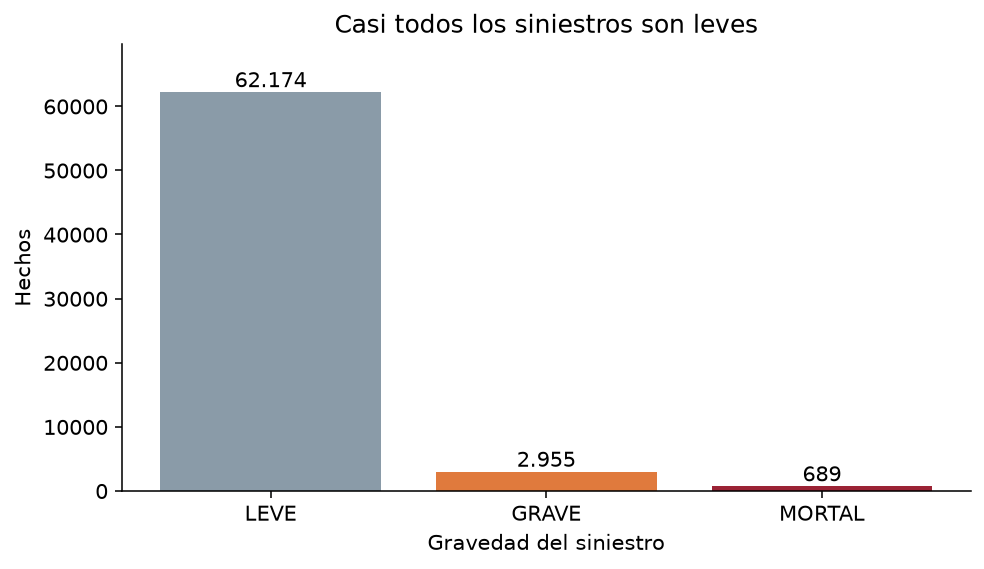

De 65.818 hechos, 62.174 son leves (94,5 %), 2.955 graves (4,5 %) y 689 mortales (1,0 %). Graves y mortales casi no se ven al lado de los leves. Esa es la forma del problema de clasificación.

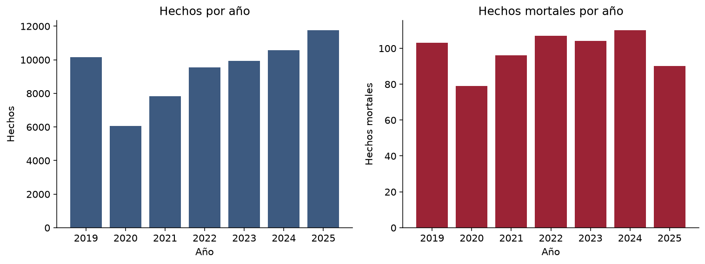

En 2020 los hechos bajan a 6.061, frente a 10.155 en 2019, y después suben hasta 11.752 en 2025. Los mortales se mantienen entre 79 y 110 por año. En 2025 la tasa es la más baja de la serie (0,77 %). El bache de 2020 coincide con la caída de movilidad de la pandemia y hay que tenerlo presente si se usa la serie completa.

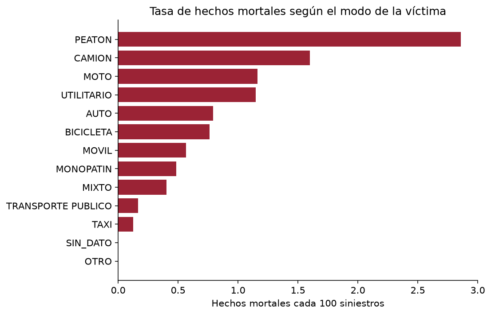

La moto aporta 285 de los 689 hechos mortales. El peatón aporta 269, con una tasa más alta: 2,86 % de sus hechos, contra 1,16 % en la moto. Los 10.929 hechos sin modo informado son todos no mortales.

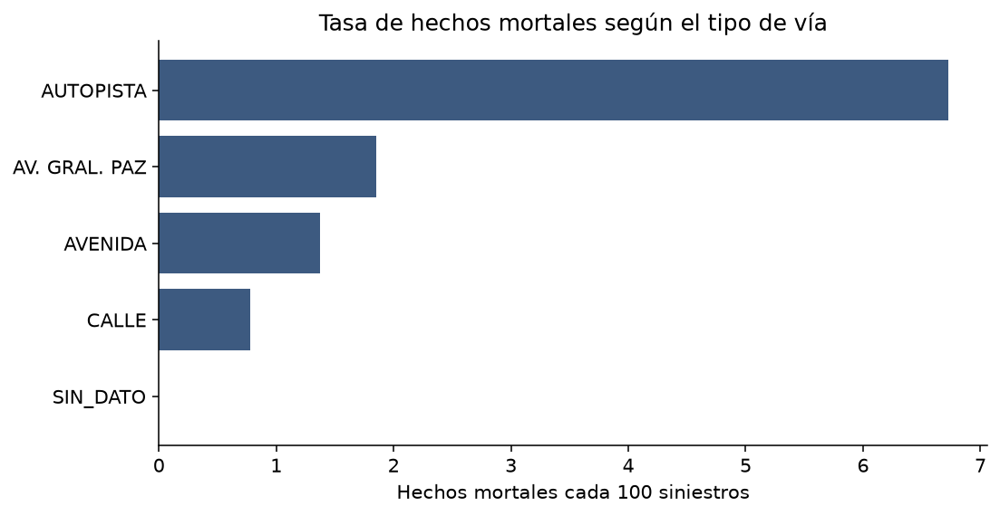

La autopista tiene 1.041 hechos y una tasa de 6,72 %. La calle, con muchos más hechos, queda en 0,78 %. El gráfico es una tasa: la barra larga es el grupo más riesgoso, no el más frecuente.

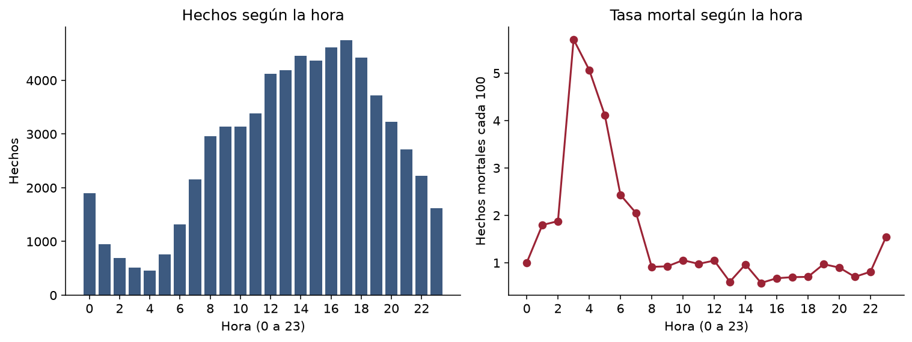

A la izquierda está el conteo: el pico es la tarde. A la derecha está la tasa: entre las 3 y las 5 de la madrugada ronda el 5 %. A las 14, en el entrenamiento, la tasa es 0,95 %; a las 3 es 6,37 %. Esta figura es la que descarta rellenar la hora vacía con la media.

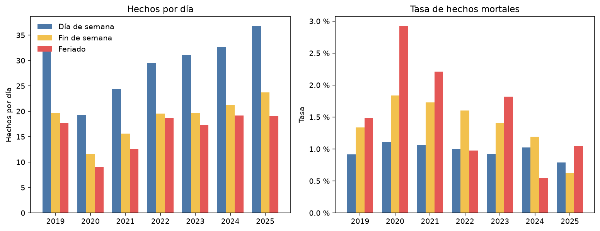

Un feriado que cae sábado o domingo entra como feriado, no como fin de semana. Los feriados de 2021 a 2025 salen de `https://api.argentinadatos.com/v1/feriados/{año}`. 2019 y 2020 responden 404 en esa API. Esos dos años se arman con la misma regla de traslado, que reproducida sobre 2021-2025 cae dentro de las fechas de la API, más los tres puentes turísticos de cada año. La lista queda en `data/feriados_nacionales_2019-2025.csv`.

En los siete años el día de semana tiene más hechos por día que el fin de semana, y el fin de semana más que el feriado: 29,4, 18,7 y 16,3. El día de semana son 1.719 fechas y el feriado 136, así que el conteo bruto agranda todavía más esa diferencia. 2020 baja las tres series y deja el mismo orden.

La tasa mortal va al revés en casi toda la serie: 0,96 % en día de semana (484 de 50.481), 1,33 % en fin de semana (174 de 13.119) y 1,40 % en feriado (31 de 2.218). Esas 31 muertes son entre 2 y 6 por año. En 2020 el feriado queda en 2,92 % con 5 muertes, y en 2024 en 0,55 % con 2. El fin de semana queda por encima del día de semana de 2019 a 2024. En 2025 queda por debajo: 0,63 % contra 0,79 %.

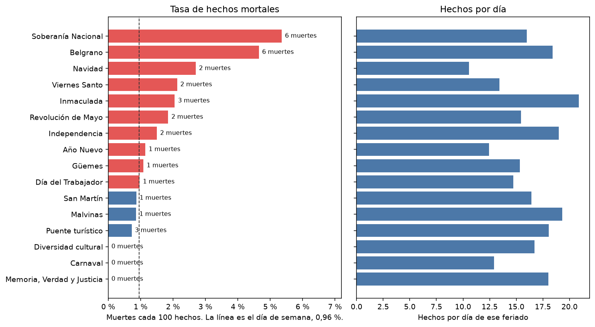

Esas 31 muertes no se reparten parejo. Soberanía Nacional tiene 6 en 112 hechos (5,36 %) y Belgrano otras 6 en 129 (4,65 %). La línea del gráfico es el 0,96 % del día de semana. Soberanía suma una muerte en seis años distintos. Belgrano suma dos en 2019, 2021 y 2022. Navidad tiene 2 muertes, las dos de 2020, y es el feriado con menos hechos por día (10,6). Carnaval, 181 hechos en catorce días, no tiene ninguna. Memoria, Verdad y Justicia tampoco, en 126. El puente turístico queda en 0,72 %, por debajo del día de semana.

### 3.3 Preprocesamiento

Acá se separan tres operaciones. El escalado no equilibra las clases. El peso de clase no rellena huecos. La media no existe para una categoría.

El reparto es 80/20, estratificado por los tres niveles, con semilla 42, y se hace antes de calcular cualquier media. El entrenamiento queda con 52.654 filas: 49.739 leves, 2.364 graves y 551 mortales. La prueba queda con 13.164 filas: 12.435 leves, 591 graves y 138 mortales.

El flujo de la figura sale de `docs/diagramas/01_pipeline.mmd`, renderizado a SVG con [Pele](https://pele.run/). Los otros diagramas de esta sección se arman igual: el fuente `.mmd` queda al lado del `.svg`.

#### Qué entra y qué no

Entran mes, día, hora, comuna, tipo de vía, modo de la víctima y contraparte.

No entran:

- `gravedad_siniestro`, porque es la etiqueta.
- Los tres conteos de víctimas por gravedad, porque la reconstruyen.
- `id_siniestro`, porque el prefijo ya es la etiqueta.
- `participantes_siniestro`, porque repite modo y contraparte.
- Latitud y longitud, que sirven para ubicar el hecho y no para esta matriz.
- `numero_total_de_victimas`, que queda para una prueba posterior: no determina solo si el hecho fue mortal, y puede dominar al resto.

#### Imputación

En las columnas que entran, el único nulo numérico es la hora: 81 filas (67 en el entrenamiento y 14 en la prueba). Una de esas 81 es un hecho mortal. Mes, día y las categorías no tienen nulos; el faltante categórico ya es `SIN_DATO`.

A modo, vía, comuna y contraparte no se les puede imputar la media. No hay un promedio entre moto y peatón. `SIN_DATO` sigue como categoría y, en el entrenamiento, aparece en las cuatro: 8.747 modos, 10.007 vías, 2.809 comunas y 11.273 contrapartes. En el archivo completo, ese faltante no aparece entre los mortales en modo, vía ni comuna. Si entra como categoría, el modelo puede estar leyendo qué tan completo quedó el sumario. Se deja visible a propósito, para no esconderlo dentro de otra clase.

En la hora sí hay media. En el entrenamiento es 13,64 y la mediana es 14. Las dos caen en la tarde. En ese mismo conjunto, la tasa mortal a las 14 es 0,95 % y a las 3 es 6,37 %. Rellenar el hueco con 13,64 o con 14 le inventa al hecho una hora de baja tasa. Por eso no se guarda ni la media ni la mediana.

Se guarda `hora_faltante`, que vale 1 si la hora no vino y 0 si vino. Para que la matriz no tenga celdas vacías, la hora escalada de esas filas queda en 0. Ese 0 es el centro de la escala, no las 14. Una hora real cercana a la media también queda cerca de 0, pero con el indicador en 0. Las dos filas no coinciden.

#### Escalado

`StandardScaler` resta la media del entrenamiento y divide por su desvío. Se aplica a mes, día y hora observada. No se aplica a la etiqueta: LEVE, GRAVE y MORTAL no se escalan, y no son una entrada del modelo. Las dummies quedan en 0 y 1.

En el entrenamiento, después del escalado, mes, día y hora observada tienen media 0 y desvío 1. Antes, el mes iba de 1 a 12, el día de 1 a 31 y la hora de 0 a 23. Esas escalas distintas harían que, en una regresión, el día pesara más que el mes solo por el rango.

La hora es circular. Las 23 y las 0 quedan en puntas opuestas de la recta, aunque en el reloj están a una hora. El escalado multiplica las distancias por una constante y no dobla esa recta. Una codificación con seno y coseno resolvería el ciclo. Queda anotada y no se construyó un segundo pipeline.

La matriz final tiene 54 columnas: 2 de calendario, 2 de hora (valor escalado e indicador) y 50 dummies. No quedó ningún nulo. El pipeline ajustado está en `data/preprocesado/pipeline.joblib`. La lista de columnas está en `data/preprocesado/columnas_finales.txt`. Para volver a cargarlo, el directorio del proyecto tiene que estar en el path de Python, porque la hora usa `src/escala_hora.py`.

#### Los tres niveles


El leve ocupa casi todo el gráfico: 62.174 hechos, el 94,5 %. El grave son 2.955, el 4,5 %. El mortal son 689, el 1 %.

El peso de una clase es la cantidad de filas de entrenamiento dividida por (3 × las filas de esa clase). Con 52.654 filas:

- leve: 52.654 / (3 × 49.739) = 0,353
- grave: 52.654 / (3 × 2.364) = 7,424
- mortal: 52.654 / (3 × 551) = 31,854

Esos pesos se guardan en `data/preprocesado/pesos_clase.json`. No modifican la matriz. Se usan cuando se ajusta el modelo. Cada fila mortal tira del ajuste unas 90 veces más que cada fila leve, y cada fila grave unas 21 veces más. No se copia ni se borra ningún siniestro.

Igualar las tres clases al tamaño de la mortal dejaría 2.067 filas y descartaría 63.751. Por eso no se guarda ese recorte.

### 3.4 Modelos, hiperparámetros, matriz y reporte

`notebooks/03_modelos.ipynb` parte el CSV limpio con la misma semilla y el mismo 80/20 estratificado por los tres niveles, carga el pipeline ya ajustado y transforma la prueba. El piso predice siempre leve.

| Modelo | Hiperparámetros | Acierto | Recall macro | Recall grave | Recall mortal |
| --- | --- | ---: | ---: | ---: | ---: |
| Siempre leve | predicción fija | 94,5 % | 33,3 % | 0 % | 0 % |
| Regresión logística | max_iter 1000, semilla 42 | 59,2 % | 61,7 % | 50,3 % | 75,4 % |
| Árbol | profundidad 5, hoja mínima 20 | 65,7 % | 57,3 % | 19,3 % | 84,8 % |
| Random forest | 200 árboles, profundidad 8, hoja mínima 10 | 54,8 % | 62,1 % | 46,7 % | 84,8 % |

En la matriz, la fila es lo que pasó y la columna es lo que dijo el modelo. El orden de las dos es leve, grave, mortal. La diagonal son los aciertos de cada nivel.

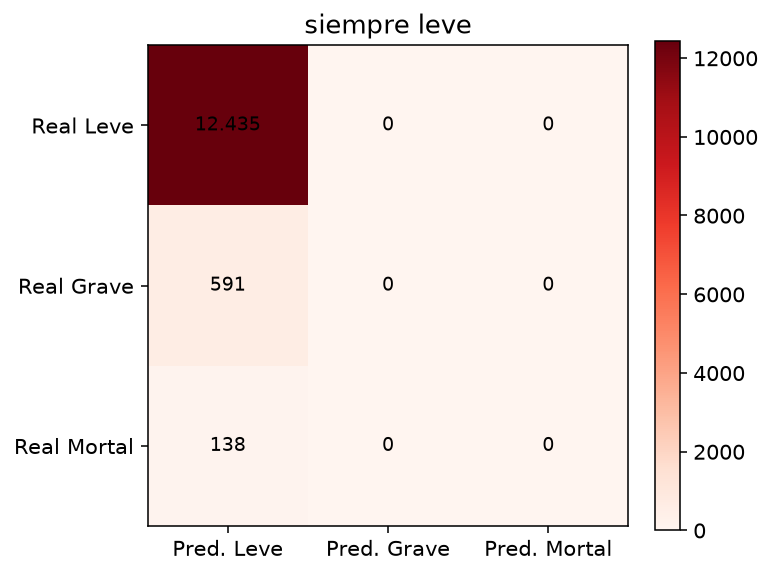

El piso acierta los 12.435 leves y no encuentra ningún grave ni ningún mortal. El acierto es 94,5 %.

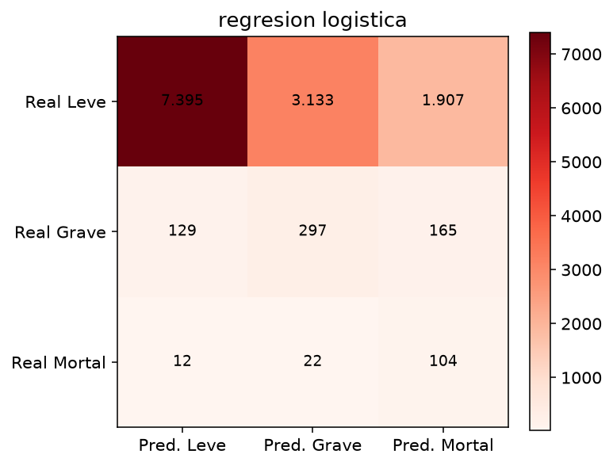

La logística encuentra 297 de 591 graves y 104 de 138 mortales. Llama leves a 12 muertes.

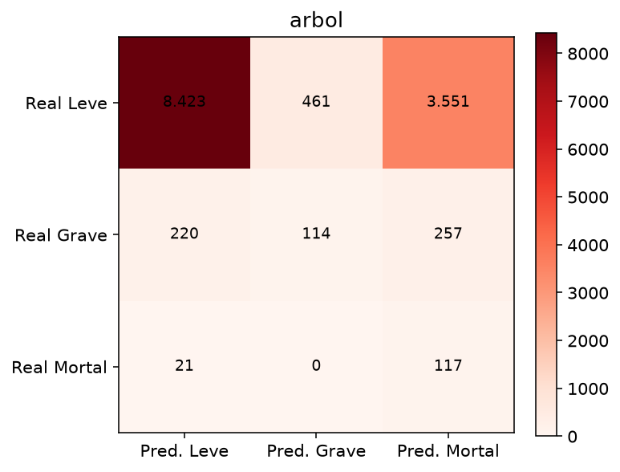

El árbol encuentra 117 de 138 mortales y solo 114 de 591 graves. El recall del grave queda en 19,3 %.

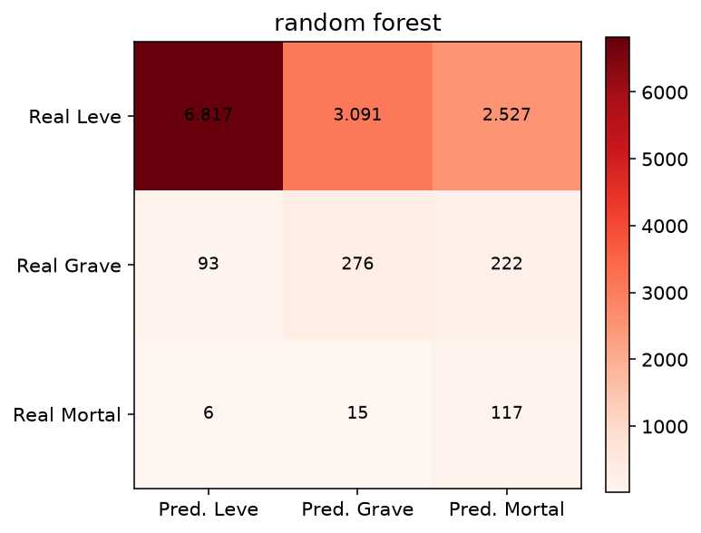

El forest encuentra 117 de 138 mortales y 276 de 591 graves. De las 21 muertes que no nombra como mortales, 15 quedan como graves y 6 como leves.

El reporte de clasificación sale de `classification_report` en esa notebook, sobre las 13.164 filas de prueba. Para el forest, el recall es 0,548 en leve, 0,467 en grave y 0,848 en mortal. La precisión del grave es 0,082 y la del mortal es 0,041. El F1 macro es 0,307. El acierto es 0,548.

Se elige el random forest. Su recall macro es 0,621, por encima de 0,617 de la logística y de 0,573 del árbol. El árbol empata el recall del mortal, 0,848, y se cae en el grave. El acierto no entra en la elección: el piso, con 0,945, no nombra ni un grave ni un mortal.

## 4. Conclusiones

Con el 94,5 % de leves, el acierto premia al modelo que dice siempre leve. El piso lo muestra en la misma prueba: 94,5 % de acierto, 0 graves y 0 muertes.

El random forest de 200 árboles y profundidad 8, con el peso de los tres niveles, es el que mejor sostiene los tres recall a la vez: 54,8 % en leve, 46,7 % en grave y 84,8 % en mortal. Encuentra 117 de 138 muertes y 276 de 591 graves.

Parte del error se mueve al nivel de al lado. De las 138 muertes, 15 quedan clasificadas como graves y 6 como leves. De los 591 graves, 222 quedan como mortales y 93 como leves. El modelo separa los tres nombres, y la precisión de grave y de mortal sigue siendo baja.

El calendario se lee en hechos por día. En los siete años el día de semana queda arriba (29,4), el fin de semana en el medio (18,7) y el feriado abajo (16,3). La tasa mortal del fin de semana supera a la del día de semana de 2019 a 2024. La del feriado apoya en 31 muertes.

## 5. Problemas y desafíos

El desbalance. Sin el peso de clase, el ajuste se va a las 49.739 filas leves del entrenamiento y el recall del grave y del mortal se acercan al del piso.

`SIN_DATO` en modo, vía y comuna no aparece entre los mortales. La categoría puede estar leyendo la calidad del sumario, no el siniestro. Dejarla visible evita esconder el problema y no lo resuelve.

La hora es circular y 2020 es un año de poca movilidad. Una hora en línea recta y una serie junta dejan las dos cosas adentro del mismo ajuste. A eso se suman 31 hechos publicados como leves con un conteo de graves, que se respetaron tal como vinieron, y una muerte con la hora vacía.

## 6. Líneas futuras

Cruzar edad y sexo desde el CSV de víctimas de la misma ficha. Ese archivo pesa 4,1 MB y no entró en esta matriz.

Probar `numero_total_de_victimas` como variable, y repetir la prueba sin ella. Quedó afuera porque puede dominar al resto y no determina por sí sola si el hecho fue mortal.

Codificar la hora con seno y coseno, y repetir la evaluación con un corte temporal: entrenar hasta 2023 y medir 2024-2025, para ver si el bache de 2020 deja el mismo recall.
